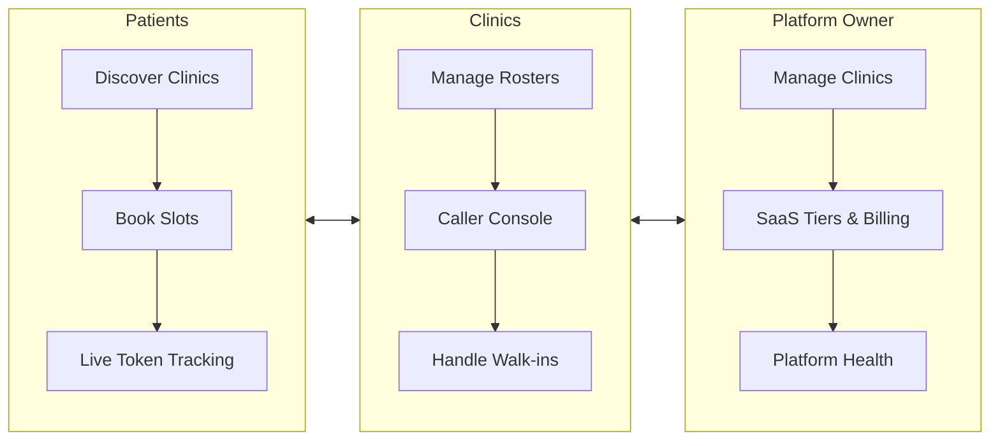
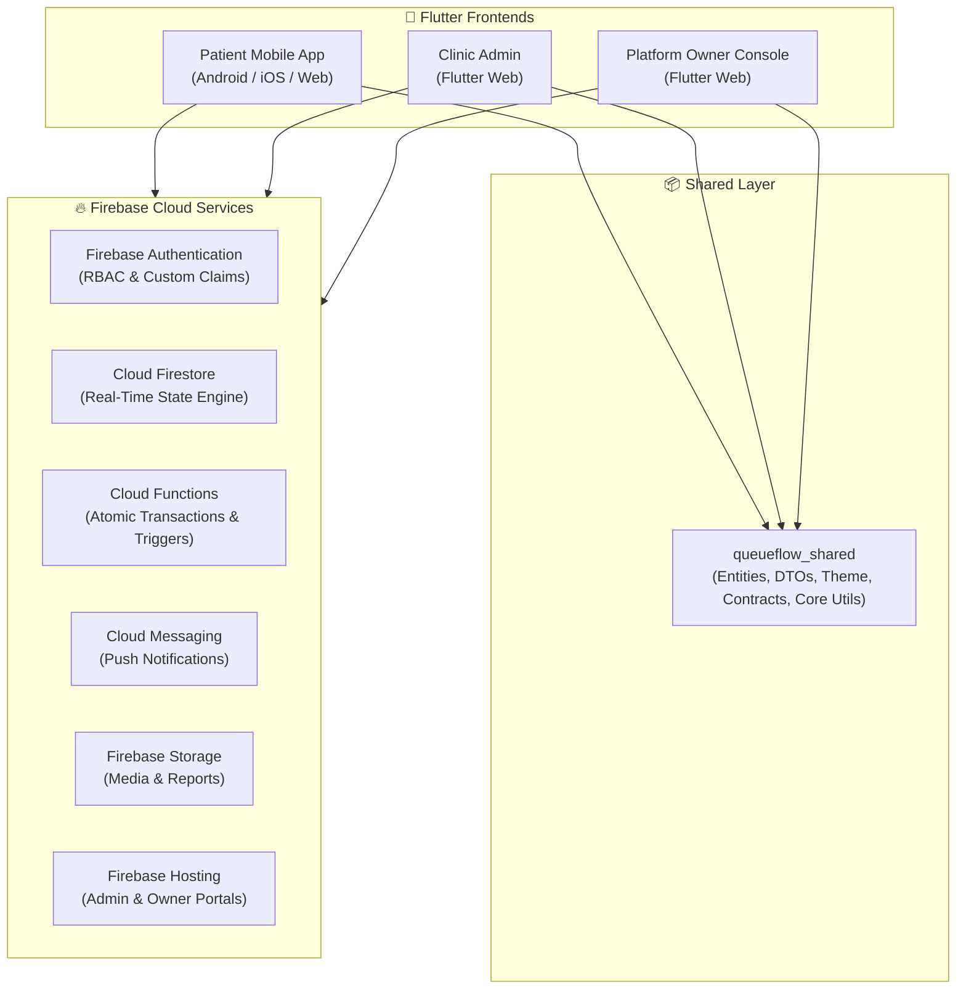
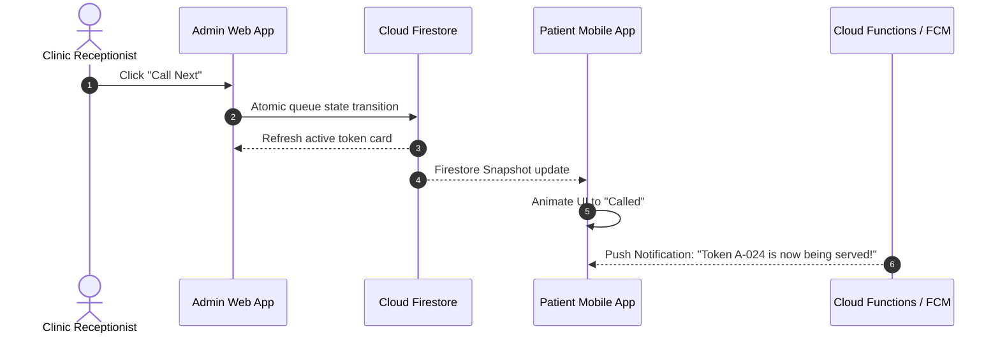

<div align="center">

# 🏥 QueueFlow

### *Book Smarter. Wait Less.*

**Real-Time Clinic Queue Management & Smart Appointment Booking Platform**

[](https://flutter.dev)
[](https://dart.dev)
[](https://firebase.google.com)
[](#-platform-suite)
[](#-system-architecture)
[](LICENSE)
[](#-contributing)

<br/>

**Discover Clinics · Book Appointments · Track Queues in Real Time**

<br/>

[About](#-1-about-queueflow) •
[Problem & Solution](#-2-problem--solution) •
[Platform Suite](#-3-platform-applications) •
[Roles & RBAC](#-4-user-roles--permissions) •
[Features](#-5-features-breakdown) •
[Architecture](#-6-system-architecture) •
[Monorepo](#-7-monorepo-folder-structure) •
[Quick Start](#-8-installation--setup) •
[Roadmap](#-9-5-week-roadmap)

<br/>

</div>

---

## 📑 Table of Contents

- [1. About QueueFlow](#-1-about-queueflow)
- [2. Problem & Solution](#-2-problem--solution)
- [3. Platform Applications](#-3-platform-applications)
- [4. User Roles & Permissions](#-4-user-roles--permissions)
- [5. Features Breakdown](#-5-features-breakdown)
  - [5.1 Patient Application](#51-patient-application)
  - [5.2 Clinic Admin Web Portal](#52-clinic-admin-web-portal)
  - [5.3 Platform Owner Console](#53-platform-owner-console)
- [6. System Architecture](#-6-system-architecture)
- [7. Monorepo Folder Structure](#-7-monorepo-folder-structure)
- [8. Technology Stack](#-8-technology-stack)
- [9. Database Design](#-9-database-design)
- [10. Real-Time Queue & Automation](#-10-real-time-queue--automation)
- [11. Clinic Subscription Plans](#-11-clinic-subscription-plans)
- [12. Installation & Setup](#-12-installation--setup)
- [13. Testing & Quality Assurance](#-13-testing--quality-assurance)
- [14. 5-Week Roadmap](#-14-5-week-roadmap)
- [15. Security & Compliance](#-15-security--compliance)
- [16. Contributing](#-16-contributing)
- [17. License](#-17-license)

---

## 🩺 1. About QueueFlow

**QueueFlow** is a digital appointment booking and real-time queue management system tailored for outpatient healthcare practices, including:

- 🏥 General medical clinics & primary care
- 🦷 Dental clinics
- 🧴 Dermatology & specialized clinics
- 🔬 Diagnostic centres & pathology laboratories
- 👥 Multi-doctor group practices

### Mission
To replace uncertain physical waiting with transparent, organized, and real-time digital queue management.

### Vision
To make healthcare visits more predictable for patients and daily clinic operations more efficient for healthcare providers.

---

## 🚨 2. Problem & Solution

### The Challenge
Traditional outpatient workflows rely on phone calls, paper slips, and crowded waiting rooms.
- **For Patients:** Zero visibility into queue progress, wasted hours in waiting rooms, and missed turns.
- **For Clinics:** Reception bottlenecks, disorganized walk-in vs. appointment schedules, and manual coordination.
- **For Platform Owners:** Fragmented clinic administration and no unified view of multi-tenant subscriptions.

### The QueueFlow Solution



---

## 📱 3. Platform Applications

QueueFlow delivers three distinct, purpose-built interfaces sharing a unified backend:

| Application | Target Audience | Supported Platforms | Core Responsibilities |
|---|---|---|---|
| **Patient App** | Patients & Caregivers | `Android` • `iOS` • `Web` | Clinic search, 4-step booking, live queue position, notifications, booking history. |
| **Clinic Admin** | Receptionists & Doctors | `Web (Desktop/Tablet)` | Live queue caller, appointment calendar, walk-in intake, doctor schedules, service catalog. |
| **Platform Owner** | SaaS Super Admins | `Web (Desktop)` | Multi-clinic directory, onboarding, subscription plan limits, MRR analytics, audit logs. |

---

## 👥 4. User Roles & Permissions

Security and access control are enforced at the database level using Firebase Authentication Custom Claims and Cloud Firestore Security Rules:

| Role | Primary Interface | Scope of Access |
|---|---|---|
| `customer` | Patient Mobile App | Own profile, own bookings, personal queue tickets, public clinic info |
| `staff` | Clinic Admin Portal | Assigned clinic appointments, queue operations, roster management |
| `admin` | Platform Owner Console | Platform-wide tenant management, billing, plan limits, system audits |

---

## ✨ 5. Features Breakdown

### 5.1 Patient Application

- **Clinic Discovery:** Filter by specialty, location, facilities, and verified patient ratings.
- **4-Step Booking Wizard:**
  1. *Select Service* — Duration and consultation pricing.
  2. *Select Doctor* — Specialty, experience, and profile details.
  3. *Select Date & Slot* — Validated real-time slot availability.
  4. *Confirmation* — Unique reference generated (e.g., `QF-48210`).
- **Live Virtual Queue Tracker:**
  - Token number (e.g., `A-024`) vs. current serving token (`A-021`).
  - People ahead count and dynamic estimated wait time.
  - Real-time 5-stage progress timeline:
    $$\text{Joined} \longrightarrow \text{Waiting} \longrightarrow \text{Almost Your Turn} \longrightarrow \text{Called} \longrightarrow \text{Completed}$$
- **My Bookings:** Manage upcoming, completed, and rescheduled appointments.
- **Push Alerts:** Triggered when turn is approaching or appointment status updates.

### 5.2 Clinic Admin Web Portal

- **Live Queue Caller:**
  - `Call Next` — Advance queue to the next waiting patient.
  - `Skip / No-Show` — Flag skipped tickets according to clinic policy.
  - `Mark Complete` — Complete the active consultation.
  - `Pause / Resume` — Temporarily hold queue progression.
- **Dual-View Schedule:** Toggle between daily/weekly calendars and status-filtered lists.
- **Walk-in Intake:** Fast registration of walk-in patients with seamless token integration.
- **Operations Management:** Doctor rosters, consultation room allocations, and service catalogs.
- **Clinic Settings:** Operating hours, break intervals, and queue cutoff thresholds (e.g., stop walk-ins 30 mins before closing).

### 5.3 Platform Owner Console

- **Tenant Directory:** Complete multi-clinic registry with instant activation/suspension toggles.
- **SaaS Subscription Configurator:** Customize plan tiers, doctor limits, and staff seat quotas.
- **Financial Intelligence:** Monthly Recurring Revenue (MRR), invoice history, and billing states.
- **Tamper-Proof Audit Trail:** Comprehensive logs of administrative actions.

---

## 🏗️ 6. System Architecture

QueueFlow is built on a **Monorepo + Feature-First Clean Architecture** standard:



### Queue Calling Interaction



---

## 📂 7. Monorepo Folder Structure

```text
queueflow/
│
├── apps/
│   ├── patient_app/            # Flutter Mobile & Web app
│   │   ├── lib/core/           # Routing, constants, theme
│   │   ├── lib/features/       # Auth, clinics, appointments, queue, profile
│   │   └── pubspec.yaml
│   │
│   ├── clinic_admin/           # Flutter Web portal for clinic operations
│   │   ├── lib/features/       # Caller console, schedule, rosters, settings
│   │   └── pubspec.yaml
│   │
│   └── platform_owner/         # Flutter Web portal for SaaS platform admin
│       ├── lib/features/       # Tenant management, billing, plans, analytics
│       └── pubspec.yaml
│
├── packages/
│   └── queueflow_shared/       # Shared Dart library
│       ├── lib/models/         # User, Clinic, Doctor, Appointment, Queue, Ticket
│       ├── lib/widgets/        # Shared design system components
│       └── pubspec.yaml
│
├── backend/
│   ├── functions/              # Node.js TypeScript Cloud Functions
│   ├── firestore.rules         # Strict access rules
│   ├── firestore.indexes.json  # Query performance indexes
│   └── storage.rules           # Storage security
│
├── analysis_options.yaml       # Strict multi-project linter rules
└── README.md
```

---

## 🛠️ 8. Technology Stack

- **Frontend:** [Flutter](https://flutter.dev) (Dart 3.x) with Riverpod / BLoC State Management
- **Database & Sync:** [Cloud Firestore](https://firebase.google.com/docs/firestore)
- **Authentication:** [Firebase Auth](https://firebase.google.com/docs/auth) with Custom Claims
- **Serverless Automation:** [Firebase Cloud Functions](https://firebase.google.com/docs/functions) (Node.js / TypeScript)
- **Push Messaging:** [Firebase Cloud Messaging (FCM)](https://firebase.google.com/docs/cloud-messaging)
- **Storage & Hosting:** [Firebase Storage](https://firebase.google.com/docs/storage) & [Firebase Hosting](https://firebase.google.com/docs/hosting)

---

## 🗄️ 9. Database Design

```
users          { id, name, email, phone, role, fcmToken, createdAt }
clinics        { id, name, category, address, lat, lng, planId, isQueueOpen, operatingHours }
services       { id, clinicId, name, durationMin, price, assignedDoctorIds, status }
doctors        { id, clinicId, name, specialty, room, schedule, status }
appointments   { id, bookingRef, clinicId, customerId, doctorId, serviceId, slot, status }
queues         { id, clinicId, doctorId, date, currentToken, totalIssued, waitingCount, status }
tickets        { id, token, queueId, clinicId, customerId, position, status, joinedAt, calledAt }
invoices       { id, clinicId, plan, amount, status, date, method }
```

---

## ⚡ 10. Real-Time Queue & Automation

1. **Atomic Token Generation:** Cloud Functions execute Firestore transactions to ensure sequential, duplicate-free token allocation (`A-001`, `A-002`) under high concurrency.
2. **Dynamic Wait Times:** Calculated transparently:
   $$\text{Estimated Wait} \approx \text{Tickets Ahead} \times \text{Avg. Service Duration}$$
3. **Reactive Subscriptions:** Firestore listeners instantly push token progress to mobile screens without client polling.

---

## 💳 11. Clinic Subscription Plans

| Tier | Monthly Rate | Annual Monthly Rate | Limits |
|---|---:|---:|---|
| **Solo Doctor** | ₹999 | ₹799 | 1 Doctor • 1 Service • 1 Staff Account |
| **Multi-Doctor** | ₹2,999 | ₹2,399 | Up to 10 Doctors • 10 Services • 5 Staff Accounts |
| **Enterprise** | ₹6,999 | ₹5,599 | Unlimited Doctors & Services • 20 Staff Accounts • Priority Support |

---

## 🚀 12. Installation & Setup

### Prerequisites
- [Flutter SDK](https://docs.flutter.dev/get-started/install) (`>= 3.20.0`)
- [Dart SDK](https://dart.dev/get-dart) (`>= 3.3.0`)
- [Node.js](https://nodejs.org/) (`>= 18.x`)
- [Firebase CLI](https://firebase.google.com/docs/cli) & [FlutterFire CLI](https://firebase.flutter.dev/docs/cli/)

### 1. Clone Repository
```bash
git clone https://github.com/your-username/queueflow.git
cd queueflow
```

### 2. Configure Shared Package
```bash
cd packages/queueflow_shared
flutter pub get
cd ../..
```

### 3. Connect Firebase Projects
```bash
firebase login
dart pub global activate flutterfire_cli

# Configure each app:
cd apps/patient_app && flutterfire configure && cd ../..
cd apps/clinic_admin && flutterfire configure && cd ../..
cd apps/platform_owner && flutterfire configure && cd ../..
```

### 4. Run the Apps

<details open>
<summary><b>📱 Patient Mobile App</b></summary>

```bash
cd apps/patient_app
flutter pub get
flutter run
```
</details>

<details>
<summary><b>🏥 Clinic Admin Web Portal</b></summary>

```bash
cd apps/clinic_admin
flutter pub get
flutter run -d chrome
```
</details>

<details>
<summary><b>👑 Platform Owner Console</b></summary>

```bash
cd apps/platform_owner
flutter pub get
flutter run -d chrome
```
</details>

<details>
<summary><b>⚡ Firebase Cloud Functions & Emulators</b></summary>

```bash
cd backend/functions
npm install
npm run build
firebase emulators:start
```
</details>

---

## 🧪 13. Testing & Quality Assurance

```bash
# Static analysis
flutter analyze apps/patient_app
flutter analyze apps/clinic_admin
flutter analyze apps/platform_owner
flutter analyze packages/queueflow_shared

# Unit & Widget tests
flutter test apps/patient_app
flutter test apps/clinic_admin
flutter test packages/queueflow_shared
```

---

## 🗓️ 14. 5-Week Roadmap

- **Week 1: Foundations & Auth** — Monorepo setup, shared package contracts, Firebase Auth RBAC, and Firestore seed data.
- **Week 2: Patient App** — Clinic search, 4-step booking wizard, and live queue tracker UI.
- **Week 3: Clinic Admin Portal** — Live queue caller console, calendar views, and doctor roster management.
- **Week 4: Cloud Automation & Platform Owner** — Atomic token Cloud Functions, push notifications, and SaaS billing dashboard.
- **Week 5: QA & Deployment** — Firebase Hosting deployments, release app bundles, and security rule hardening.

---

## 🔐 15. Security & Compliance

- **Zero Client-Side Token Escalation:** Token allocation and position updates are strictly verified on serverless Cloud Functions.
- **Tenant Isolation:** Staff permissions are scoped to their assigned `clinicId`.
- **Privacy-by-Design:** Collects only minimal required consultation data with granular Firestore read/write rules.

---

## 🤝 16. Contributing

1. Fork the Project
2. Create your Feature Branch (`git checkout -b feature/AmazingFeature`)
3. Commit your Changes (`git commit -m 'feat: add AmazingFeature'`)
4. Push to the Branch (`git push origin feature/AmazingFeature`)
5. Open a Pull Request

---

## 📄 17. License

Distributed under the **MIT License**. See [`LICENSE`](LICENSE) for details.

---

<div align="center">

**QueueFlow** — *Book Smarter. Wait Less.*

Built with ❤️ using **Flutter & Firebase**

</div>