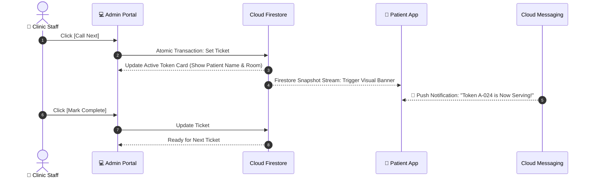

<div align="center">

# 🏥 QueueFlow — Clinic Admin Web Portal

### *Streamlined Clinic Operations & Real-Time Queue Control*

**A responsive Flutter Web application designed for clinic receptionists, doctors, and practice managers.**

[](https://flutter.dev/multi-platform/web)
[](https://dart.dev)
[-blue)](#-supported-environments)
[](https://firebase.google.com)
[](#-application-architecture)
[](../../LICENSE)

<br/>

**Live Queue Caller · Walk-In Registration · Appointment Calendar · Doctor Rosters · Clinic Operations**

<br/>

[Overview](#-overview) •
[Core Features](#-core-features) •
[Queue Caller Workflow](#-live-queue-caller-workflow) •
[Architecture](#-application-architecture) •
[Folder Structure](#-folder-structure) •
[Getting Started](#-getting-started) •
[Deployment](#-production-deployment)

<br/>

</div>

---

## 📖 Overview

The **QueueFlow Clinic Admin Portal** is an operational web dashboard engineered specifically for outpatient clinic staff. It bridges the gap between pre-booked appointments and physical walk-in patients, giving receptionists and physicians full command over daily patient flow.

With live synchronization powered by Cloud Firestore, any queue action taken on this portal—such as calling the next token or flagging a no-show—instantly updates the patient's mobile app and triggers push notifications.

```
┌────────────────────────────────────────────────────────────────────────┐
│                        🏥 Clinic Admin Suite                           │
├─────────────────┬──────────────────┬─────────────────┬─────────────────┤
│  📢 Live Queue  │  📅 Appointment  │  🚶 Walk-In     │  👨‍⚕️ Roster &   │
│     Caller      │     Calendar     │     Intake      │    Operations   │
│                 │                  │                 │                 │
│ Call next, skip │ Dual list/cal    │ Quick patient   │ Shifts, room    │
│ no-show, pause, │ views, filter by │ entry with auto │ assignments,    │
│ complete visit  │ doctor & status  │ token dispatch  │ fee catalogs    │
└─────────────────┴──────────────────┴─────────────────┴─────────────────┘
```

---

## ✨ Core Features

### 1. 📢 Live Queue Caller Console
The heartbeat of daily clinic operations. Built with high-visibility typography for reception counters and doctor desks:
- **Active Token Display:** Large digital readout showing active token (`A-024`), patient name, assigned doctor, and consultation room.
- **`Call Next`:** Atomically fetches and calls the next eligible waiting ticket.
- **`Skip / No-Show`:** Flags skipped tickets in compliance with clinic grace-period rules.
- **`Mark Complete`:** Concludes the active consultation and records visit duration.
- **`Pause / Resume Queue`:** Temporarily halts queue progression (e.g., during emergency cases or doctor breaks).

### 2. 📋 Real-Time Queue Management Table
- Live overview of all waiting, called, and skipped tokens.
- Dynamic indicators showing wait duration and patient queue position.
- Quick-access **Patient Drawer** to view medical visit history, contact numbers, and notes.

### 3. 📅 Appointment Scheduling & Calendar
- **Dual Display Modes:** Switch seamlessly between **Interactive Daily/Weekly Calendar** and **Filtered List View**.
- **Filter Matrix:** Filter by Doctor, Medical Service, Status (`Confirmed`, `Completed`, `Cancelled`, `No-Show`), or Date Range.
- **CSV Data Export:** Export appointment registers for accounting and reporting.

### 4. 🚶 Walk-in Patient Registration
- Rapid intake form for walk-in patients without prior digital bookings.
- Automatically assigns the next sequential token in line (`A-025`) and sends SMS confirmation if phone number is provided.

### 5. 👨‍⚕️ Doctor & Staff Roster Management
- Complete physician directory with specialties, assigned rooms, and contact details.
- Weekly shift scheduler and break allocations.
- Staff access controls scoped strictly to the clinic (`clinicId`).

### 6. 🏷️ Service & Price Catalog (CRUD)
- Manage clinical treatments and consultations.
- Define service duration (in minutes), consultation fee in Indian Rupees (₹ INR), assigned doctor IDs, and availability toggles.

### 7. ⚙️ Clinic Operating Settings
- Define weekly opening and closing schedules with custom break windows.
- **Queue Cutoff Controls:** Set walk-in intake cutoff thresholds (e.g., automatically stop issuing new tokens 30 minutes before closing).
- **Emergency Broadcasts:** Display clinic notices (e.g., "Doctor arriving 20 mins late due to emergency").

### 8. 📊 Operational Reports & Analytics
- Daily and weekly patient volume statistics.
- Average wait time trends and consultation durations.
- Peak clinic hours heatmap to optimize staff scheduling.

---

## ⚡ Live Queue Caller Workflow



---

## 🧱 Application Architecture

The Clinic Admin Portal uses **Feature-First Clean Architecture** with strict layer separation:

```text
lib/
├── core/                       # Core infrastructure
│   ├── constants/              # Asset paths, color palettes, breakpoints
│   ├── errors/                 # Network & authorization failure handlers
│   ├── router/                 # Protected web routes (GoRouter)
│   ├── theme/                  # Desktop-optimized responsive theme
│   └── utils/                  # Date helpers, CSV generators
│
└── features/                   # Autonomous feature modules
    ├── authentication/         # Staff sign-in & clinic claim validation
    ├── dashboard/              # Key operational metrics & daily summary
    ├── queue_management/       # Live caller console & queue tables
    ├── appointments/           # Calendar view, list view & walk-in entry
    ├── doctors/                # Physician directory & shift rosters
    └── clinic_settings/        # Operating hours, breaks, and queue limits
```

### Clean Architecture Layers
```text
features/<feature_name>/
├── data/
│   ├── datasources/            # Firestore clinic collections & queries
│   ├── models/                 # DTOs with JSON & Firestore converters
│   └── repositories/           # Concrete repository implementations
├── domain/
│   ├── entities/               # Immutable business entities
│   ├── repositories/           # Repository interfaces
│   └── usecases/               # Pure business use cases
└── presentation/
    ├── pages/                  # Desktop & tablet responsive page layouts
    ├── widgets/                # Reusable table rows, dialogs, caller cards
    └── state/                  # Riverpod Notifiers / BLoC state containers
```

---

## 📂 Folder Structure

```text
apps/clinic_admin/
├── web/                        # Web manifest, favicon, index.html
│   ├── favicon.png
│   └── index.html
├── lib/
│   ├── core/
│   │   ├── constants/
│   │   │   └── admin_constants.dart
│   │   ├── router/
│   │   │   └── admin_router.dart      # Protected routes (/queue, /calendar)
│   │   └── theme/
│   │       └── admin_theme.dart       # High-contrast desktop UI
│   ├── features/
│   │   ├── authentication/
│   │   ├── dashboard/
│   │   ├── queue_management/
│   │   ├── appointments/
│   │   ├── doctors/
│   │   └── clinic_settings/
│   ├── app.dart                       # MaterialApp.router configuration
│   └── main.dart                      # Web entrypoint & Firebase initialization
├── test/
│   ├── unit/                          # Queue logic & use case tests
│   └── widget/                        # Admin caller & dialog tests
├── pubspec.yaml                       # Web dependencies
└── README.md
```

---

## 🛠️ Tech Stack & Dependencies

| Layer | Technology | Purpose |
|---|---|---|
| **Language** | [Dart 3.x](https://dart.dev) | Sound null-safe application logic |
| **Framework** | [Flutter Web](https://flutter.dev/multi-platform/web) | Responsive canvas/HTML web rendering |
| **State Management** | `flutter_riverpod` / `flutter_bloc` | Unidirectional reactive state management |
| **Routing** | `go_router` | Web URL synchronization, redirects & route guards |
| **Database** | `cloud_firestore` | Low-latency real-time queue snapshot streaming |
| **Auth** | `firebase_auth` | Staff authentication with custom claims (`role: 'staff'`) |
| **Hosting** | `firebase_hosting` | Global CDN hosting for high availability |
| **Shared Lib** | `queueflow_shared` | Centralized data models, contracts & validators |

---

## 🚀 Getting Started

### Prerequisites
- [Flutter SDK](https://docs.flutter.dev/get-started/install) (`>= 3.20.0`)
- Google Chrome (or modern Chromium browser)
- [Firebase CLI](https://firebase.google.com/docs/cli) & [FlutterFire CLI](https://firebase.flutter.dev/docs/cli/)

### 1. Link Shared Package
In `apps/clinic_admin/pubspec.yaml`:
```yaml
dependencies:
  flutter:
    sdk: flutter

  queueflow_shared:
    path: ../../packages/queueflow_shared
```

### 2. Install Dependencies
```bash
cd apps/clinic_admin
flutter pub get
```

### 3. Connect Firebase Project
```bash
firebase login
flutterfire configure
```
Select your Firebase project and enable the **Web** platform target.

### 4. Run Development Server
```bash
# Run on Chrome with live reload
flutter run -d chrome
```

---

## 💻 Supported Environments

The Clinic Admin Portal is built with responsive layouts designed for:
- 🖥️ **Desktop Monitors:** (1920×1080 / 1440×900) — Recommended for reception desks and administrative offices.
- 📱 **Tablets:** (iPad / Android Tablets in Landscape mode) — Ideal for doctor consultation rooms and mobile nurses.

---

## 🧪 Testing & Code Quality

```bash
# Run static analysis
flutter analyze

# Run unit and widget tests
flutter test

# Format code
dart format .
```

---

## 🌐 Production Deployment

### 1. Build Optimized Web Bundle
Compile the Flutter Web application for production:
```bash
flutter build web --release
```
The compiled output is generated in `build/web/`.

### 2. Deploy to Firebase Hosting
From the root of your project:
```bash
firebase deploy --only hosting:clinic-admin
```

> [!TIP]
> Ensure caching headers in `firebase.json` prevent stale caching of `index.html` while allowing long-term caching of hashed assets (`main.dart.js`).

---

## 🔐 Security & Permissions Matrix

- **Role Verification:** Only accounts with the custom claim `role == 'staff'` can access routes under `/dashboard`, `/queue`, and `/settings`.
- **Clinic Scoping:** Every Firestore read and write is scoped with `request.auth.token.clinicId == resource.data.clinicId`. Cross-clinic data leakage is impossible at the database level.
- **Audit Trails:** All queue status modifications (`CALLED`, `SKIPPED`, `COMPLETED`) record the acting staff member's UID and timestamp.

---

<div align="center">

Part of the **[QueueFlow Monorepo](../../README.md)** ecosystem.

<br/>

Built with ❤️ using **Flutter Web & Firebase**

</div>