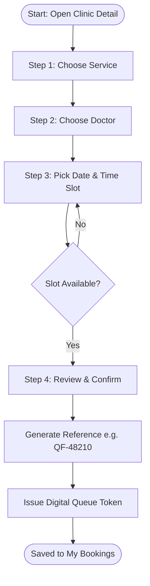
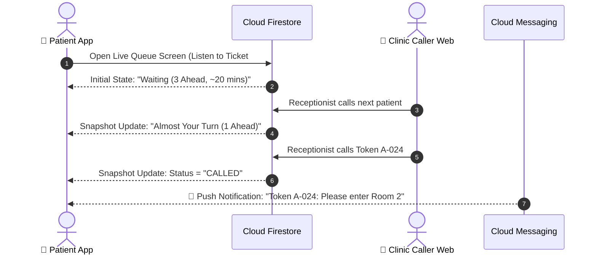

<div align="center">

# 📱 QueueFlow — Patient Mobile App

### *Book Smarter. Wait Less.*

**The real-time outpatient booking and live digital queue tracking application for patients and caregivers.**

[](https://flutter.dev)
[](https://dart.dev)
[](https://flutter.dev/multi-platform)
[](https://firebase.google.com)
[](#-application-architecture)
[](../../LICENSE)

<br/>

**Discover Outpatient Clinics · Schedule Appointments in 4 Steps · Track Token Queues in Real Time**

<br/>

[Key Features](#-key-features) •
[Booking Workflow](#-4-step-appointment-booking-flow) •
[Live Queue Tracker](#-live-queue-tracking-engine) •
[Architecture](#-application-architecture) •
[Folder Structure](#-folder-structure) •
[Getting Started](#-getting-started) •
[Build & Release](#-build--release)

<br/>

</div>

---

## 📖 Overview

The **QueueFlow Patient App** is a modern cross-platform application designed for iOS, Android, and mobile web. It addresses the common pain point of unpredictable clinic waiting times by giving patients full transparency over their queue position from their smartphones.

Instead of sitting in crowded reception areas for hours, patients can book appointments with verified doctors, reserve their digital queue ticket, monitor the live queue progress from anywhere, and arrive at the clinic right when their turn is approaching.

```
┌────────────────────────────────────────────────────────────────────────┐
│                          📱 Patient App Flow                           │
├─────────────────┬──────────────────┬─────────────────┬─────────────────┤
│  🔍 Discover    │   📅 4-Step      │  🎟️ Live Token  │  🔔 Proactive   │
│     Clinics     │      Booking     │     Tracker     │      Alerts     │
│                 │                  │                 │                 │
│ Browse doctors, │ Pick service,    │ Track serving   │ Get notified    │
│ specialties,    │ practitioner,    │ token & people  │ when your turn  │
│ and clinic fees │ date, and slot   │ ahead in real   │ is approaching  │
│                 │                  │ time            │                 │
└─────────────────┴──────────────────┴─────────────────┴─────────────────┘
```

---

## ✨ Key Features

### 1. 🔐 Frictionless Authentication & Profiles
- **Multiple Sign-in Modes:** Sign in via Email & Password, Phone SMS OTP, or Google Sign-In.
- **Session Persistence:** Secure, automatic token refresh using Firebase Authentication.
- **Patient Profile:** Manage personal details, contact information, emergency contacts, and notification preferences.

### 2. 🏥 Clinic Discovery & Doctor Rosters
- **Smart Search & Filters:** Filter healthcare providers by medical specialty (General Medicine, Dental, Dermatology, Diagnostics, Pediatrics).
- **Comprehensive Clinic Profiles:** View verified reviews, consultation fees, operating hours, amenities, and Google Maps directions.
- **Doctor Directory:** Browse physicians, their medical specialties, consultation languages, and daily schedules.

### 3. 🗓️ Guided 4-Step Booking Wizard
1. **Select Service:** Choose consultation or diagnostic procedure with upfront duration and price.
2. **Select Doctor:** Choose from available doctors or pick "Any Available Doctor".
3. **Select Date & Slot:** Pick available dates and live time slots validated against schedule conflicts.
4. **Instant Confirmation:** Submit booking and receive a unique reference code (e.g., `QF-48210`).

### 4. 🎟️ Real-Time Virtual Queue Tracker
- **Dynamic Token Card:** Displays your token number (e.g., `A-024`) alongside the currently serving token (`A-021`).
- **People Ahead Counter:** Live count of waiting patients ahead of you.
- **Dynamic Wait Estimate:** Intelligent wait approximations:
  $$\text{Estimated Wait} \approx \text{Patients Ahead} \times \text{Avg. Service Duration}$$
- **5-Stage Queue Lifecycle:**
  $$\text{Joined} \longrightarrow \text{Waiting} \longrightarrow \text{Almost Your Turn} \longrightarrow \text{Called} \longrightarrow \text{Completed}$$

### 5. 📋 Booking Management (My Bookings)
- **Categorized Tabs:** View **Upcoming**, **Completed**, and **Cancelled** visits.
- **Self-Service Actions:** Reschedule or cancel appointments within clinic cancellation policies.
- **Digital Token History:** Keep records of past visits and consultation notes.

### 6. 🔔 In-App Notification Center & Push Alerts
- Automated push notifications via Firebase Cloud Messaging (FCM) when:
  - Your appointment is confirmed or rescheduled.
  - *Almost your turn:* You are within 2–3 tokens of being called.
  - *Token called:* Your token is currently being called to the consultation room.
- In-app notification tray with unread indicators and direct route navigation.

### 7. 🎨 UI & Accessibility
- Clean, accessible healthcare UI with high contrast and intuitive navigation.
- **Light & Dark Mode** system theme synchronization.
- Smooth transitions and offline-friendly error handling.

---

## 🔄 4-Step Appointment Booking Flow



---

## ⚡ Live Queue Tracking Engine

The live queue tracker uses real-time Cloud Firestore snapshot listeners to eliminate manual screen refreshing:



---

## 🧱 Application Architecture

The patient application follows **Feature-First Clean Architecture**, ensuring business logic is isolated from UI and external frameworks.

```text
lib/
├── core/                       # App-wide infrastructure
│   ├── constants/              # Asset paths, keys, UI metrics
│   ├── errors/                 # Failure & Exception classes
│   ├── network/                # Connectivity listeners
│   ├── router/                 # Declarative routing (GoRouter)
│   └── theme/                  # Typography, light/dark palettes
│
└── features/                   # Independent feature modules
    ├── authentication/         # Login, OTP verification, register
    ├── clinics/                # Discovery, categories, clinic profiles
    ├── appointments/           # 4-step wizard, booking management
    ├── queue_tracking/         # Live token tracker & status timeline
    └── notifications/          # In-app inbox & push handler
```

### Module Layering Inside Every Feature
```text
features/<feature_name>/
├── data/
│   ├── datasources/            # Firestore remote datasources & REST calls
│   ├── models/                 # Data transfer objects (DTOs) with JSON serialization
│   └── repositories/           # Concrete implementation of domain repository
├── domain/
│   ├── entities/               # Pure Dart immutable business objects
│   ├── repositories/           # Abstract repository contracts
│   └── usecases/               # Single-responsibility use cases
└── presentation/
    ├── pages/                  # Full-screen responsive page layouts
    ├── widgets/                # Reusable feature-scoped widgets
    └── state/                  # State management controllers (Riverpod / BLoC)
```

---

## 📂 Folder Structure

```text
apps/patient_app/
├── android/                    # Android platform runner & permissions
├── ios/                        # iOS runner, Podfile & APNs config
├── web/                        # Web manifest & index.html
├── lib/
│   ├── core/
│   │   ├── constants/
│   │   │   ├── app_colors.dart
│   │   │   └── app_constants.dart
│   │   ├── errors/
│   │   │   └── exceptions.dart
│   │   ├── router/
│   │   │   └── app_router.dart
│   │   └── theme/
│   │       ├── app_theme.dart
│   │       └── text_styles.dart
│   ├── features/
│   │   ├── authentication/
│   │   ├── clinics/
│   │   ├── appointments/
│   │   ├── queue_tracking/
│   │   └── notifications/
│   ├── app.dart                # MaterialApp setup with theme & routing
│   └── main.dart               # App entrypoint (Firebase initialization)
├── test/
│   ├── unit/                   # Business use case tests
│   └── widget/                 # Component & screen widget tests
├── pubspec.yaml                # App dependencies & assets
└── README.md
```

---

## 🛠️ Tech Stack & Dependencies

| Layer | Package / Tool | Purpose |
|---|---|---|
| **Language** | [Dart 3.x](https://dart.dev) | Modern, sound null-safe programming |
| **Framework** | [Flutter 3.x](https://flutter.dev) | Cross-platform UI toolkit |
| **State Management** | `flutter_riverpod` / `flutter_bloc` | Reactive, testable state management |
| **Routing** | `go_router` | Declarative URL-based deep linking |
| **Authentication** | `firebase_auth` | Email, Phone OTP & Google Sign-In |
| **Database** | `cloud_firestore` | Real-time queue state synchronization |
| **Push Alerts** | `firebase_messaging` | Cloud push notifications (APNs / FCM) |
| **Local Storage** | `shared_preferences` | User theme & preference caching |
| **Shared Lib** | `queueflow_shared` | Monorepo models, theme tokens & DTOs |

---

## 🚀 Getting Started

### Prerequisites
- [Flutter SDK](https://docs.flutter.dev/get-started/install) (`>= 3.20.0`)
- [Dart SDK](https://dart.dev/get-dart) (`>= 3.3.0`)
- Android Studio / Xcode (with iOS Simulator & Android Emulator)
- [Firebase CLI](https://firebase.google.com/docs/cli) & [FlutterFire CLI](https://firebase.flutter.dev/docs/cli/)

### 1. Ensure Shared Package is Linked
In `apps/patient_app/pubspec.yaml`:
```yaml
dependencies:
  flutter:
    sdk: flutter

  queueflow_shared:
    path: ../../packages/queueflow_shared
```

### 2. Install Dependencies
```bash
cd apps/patient_app
flutter pub get
```

### 3. Configure Firebase for Patient App
Sign in to Firebase and generate `firebase_options.dart`:
```bash
firebase login
flutterfire configure
```
Select your Firebase project and enable **Android**, **iOS**, and optionally **Web**.

### 4. Run on a Device / Emulator

```bash
# Run on connected Android device / emulator
flutter run -d android

# Run on iOS Simulator
flutter run -d ios

# Run on Chrome (Web preview)
flutter run -d chrome
```

---

## 🧪 Testing & Quality Assurance

Maintain high code quality by running static analysis and tests:

```bash
# Run Dart linter
flutter analyze

# Run all unit and widget tests
flutter test

# Run tests with code coverage report
flutter test --coverage
```

---

## 📦 Build & Release

### Android
Generate a release Android App Bundle (AAB) for Google Play Store:
```bash
flutter build appbundle --release
```
Output: `build/app/outputs/bundle/release/app-release.aab`

### iOS
Generate an archive for TestFlight and App Store submission:
```bash
flutter build ipa --release
```
Output: `build/ios/archive/Runner.xcarchive`

### Web
Build an optimized release bundle for web deployment:
```bash
flutter build web --release
```
Output: `build/web/`

---

## 🔐 Permissions & Privacy

The Patient App requires the following device permissions:
- **Notifications (`POST_NOTIFICATIONS` / APNs):** Required to deliver queue position updates when the app is in the background.
- **Location (`ACCESS_FINE_LOCATION` / `NSLocationWhenInUseUsageDescription`):** Optional, used to display nearby clinics and calculate travel distance.
- **Network Access:** Required to communicate with Firebase and fetch clinic rosters.

---

<div align="center">

Part of the **[QueueFlow Monorepo](../../README.md)** ecosystem.

<br/>

Built with ❤️ using **Flutter & Firebase**

</div>