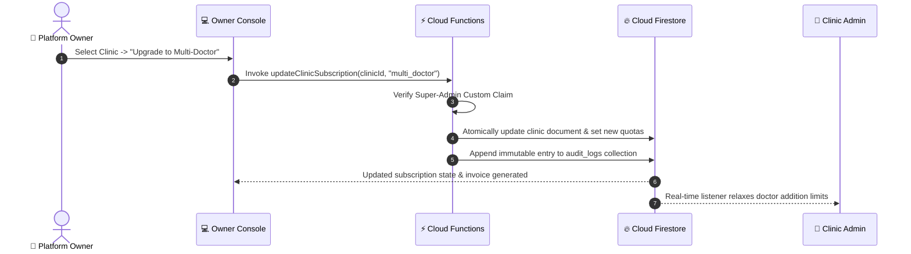

<div align="center">

# 👑 QueueFlow — Platform Owner Console

### *Centralized Multi-Tenant SaaS Administration & Operations*

**An enterprise Flutter Web administration console designed for platform owners and SaaS super administrators.**

[](https://flutter.dev/multi-platform/web)
[](https://dart.dev)
[-blue)](#-supported-environments)
[](https://firebase.google.com)
[](#-application-architecture)
[](../../LICENSE)

<br/>

**Multi-Clinic Directory · Subscription Plans · MRR & Billing · Platform Analytics · Audit Trail**

<br/>

[Overview](#-overview) •
[Core Features](#-core-features) •
[Subscription Engine](#-saas-subscription-tiers--limits) •
[Architecture](#-application-architecture) •
[Folder Structure](#-folder-structure) •
[Getting Started](#-getting-started) •
[Deployment](#-production-deployment)

<br/>

</div>

---

## 📖 Overview

The **QueueFlow Platform Owner Console** is the centralized executive command center for the QueueFlow SaaS ecosystem. Operating at the platform level above individual clinics, it gives platform owners complete oversight over tenant onboarding, subscription plans, platform billing, recurring revenue, and audit trails.

While clinic staff operate exclusively within their assigned clinic scope, the Platform Owner Console manages the business health of the entire healthcare network across all participating outpatient clinics.

```
┌────────────────────────────────────────────────────────────────────────┐
│                        👑 Platform Owner Suite                         │
├─────────────────┬──────────────────┬─────────────────┬─────────────────┤
│  🏢 Clinic      │  💳 Subscription │  📈 Financial   │  🛡️ Audit Trail  │
│     Directory   │     Engine       │     Intel & MRR │     & Security  │
│                 │                  │                 │                 │
│ Onboard, audit, │ Configure tiers, │ Track monthly   │ Immutable logs  │
│ activate, and   │ doctor limits,   │ revenue, churn, │ of privileged   │
│ suspend clinics │ & staff quotas   │ and invoices    │ tenant actions  │
└─────────────────┴──────────────────┴─────────────────┴─────────────────┘
```

---

## ✨ Core Features

### 1. 🏢 Multi-Clinic Directory & Lifecycle Management
- **Centralized Registry:** View, filter, and inspect all registered healthcare facilities across categories (General Medicine, Dental, Dermatology, Diagnostics).
- **Tenant Lifecycle Operations:**
  - `Activate Clinic` — Approve new clinic onboarding and open queue operations.
  - `Suspend Clinic` — Immediately freeze a clinic's queue and booking capabilities (e.g., in case of subscription lapse or compliance issues).
  - `Inspect Roster & Meta` — Review registered doctors, staff accounts, addresses, and geo-coordinates.

### 2. 💳 SaaS Subscription Tier Configurator
Configure and customize the limits and pricing for each subscription plan:
- **Doctor Quotas:** Limit the maximum active doctor profiles per clinic.
- **Service Catalog Limits:** Define maximum bookable services and procedures.
- **Staff Account Seats:** Allocate reception and administrative seats per clinic.
- **Dynamic Tier Upgrades:** Reassign clinic tiers with instant backend entitlement updates.

### 3. 📈 Financial Intelligence & MRR Tracking
- **Monthly Recurring Revenue (MRR) KPI:** Calculated in real time from active subscription contracts.
- **Annual Run Rate (ARR) & Churn Rate:** Monitor recurring platform revenue health.
- **Invoice Ledger:** Searchable billing records with clinic details, plan tier, transaction date, payment status (`Paid`, `Pending`, `Failed`), and download options.

### 4. 📊 Platform-Wide Usage Analytics
- Total queue tokens generated across all clinics today, this week, and all-time.
- Active patients served and average outpatient wait-time benchmarks.
- Subscription distribution charts (Solo vs. Multi-Doctor vs. Enterprise).
- Peak system load monitoring across peak outpatient consulting hours.

### 5. 🛡️ Tamper-Proof Audit Logging
- Dedicated audit journal recording all privileged actions:
  - Clinic onboarding approvals and suspensions.
  - Plan limit overrides and manual tier assignments.
  - Staff elevation and super-admin credential access.
- Audit records are stored in a write-once, immutable collection protected by Firestore security rules.

---

## 💳 SaaS Subscription Tiers & Limits

The platform owner console enforces the following multi-tenant subscription tiers:

| Plan Tier | Monthly Price | Annual Monthly Rate | Doctor Limit | Service Limit | Staff Seats |
|---|---|---|---|---|---|
| **Solo Doctor** | ₹999 / mo | ₹799 / mo | **1** Doctor | **1** Service | **1** Staff Account |
| **Multi-Doctor Clinic** | ₹2,999 / mo | ₹2,399 / mo | Up to **10** Doctors | Up to **10** Services | Up to **5** Staff Accounts |
| **Enterprise Practice** | ₹6,999 / mo | ₹5,599 / mo | **Unlimited** | **Unlimited** | Up to **20** Staff Accounts |

> [!IMPORTANT]
> Subscription quotas are enforced strictly by **Cloud Functions** and **Firestore Security Rules** during doctor/service creation to prevent unauthorized client-side tampering.

---

## 🔄 Platform Management Sequence



---

## 🧱 Application Architecture

The Platform Owner Console uses **Feature-First Clean Architecture** with strict boundary separation:

```text
lib/
├── core/                       # Core system infrastructure
│   ├── constants/              # SaaS plan configurations, UI tokens
│   ├── errors/                 # Administrative exception handling
│   ├── router/                 # Guarded routes requiring super-admin claim
│   ├── theme/                  # Professional dark/light executive UI theme
│   └── utils/                  # Currency (₹ INR) formatters, audit parsers
│
└── features/                   # Independent administrative modules
    ├── authentication/         # Super-admin multi-factor authentication
    ├── dashboard/              # Executive KPI dashboard (MRR, active clinics)
    ├── clinic_management/      # Multi-clinic directory, onboarding, suspension
    ├── subscriptions/          # Tier configuration and quota enforcement
    ├── billing/                # Invoices, transaction history, receipts
    └── analytics/              # Platform-wide outpatient volume trends
```

### Clean Architecture Layers
```text
features/<feature_name>/
├── data/
│   ├── datasources/            # Firestore root collections & admin endpoints
│   ├── models/                 # DTOs: ClinicDTO, SubscriptionDTO, InvoiceDTO
│   └── repositories/           # Concrete data persistence repositories
├── domain/
│   ├── entities/               # Pure business objects (immutable)
│   ├── repositories/           # Abstract repository interfaces
│   └── usecases/               # Pure domain use cases (e.g. SuspendClinicUseCase)
└── presentation/
    ├── pages/                  # Desktop dashboard and data table layouts
    ├── widgets/                # KPI cards, charts, audit tables, modals
    └── state/                  # State management controllers (Riverpod / BLoC)
```

---

## 📂 Folder Structure

```text
apps/platform_owner/
├── web/                        # Web manifest, icons & index.html
│   ├── favicon.png
│   └── index.html
├── lib/
│   ├── core/
│   │   ├── constants/
│   │   │   └── owner_constants.dart
│   │   ├── router/
│   │   │   └── owner_router.dart      # Super-admin route guards
│   │   └── theme/
│   │       └── owner_theme.dart       # Executive desktop theme
│   ├── features/
│   │   ├── authentication/
│   │   ├── dashboard/
│   │   ├── clinic_management/
│   │   ├── subscriptions/
│   │   ├── billing/
│   │   └── analytics/
│   ├── app.dart                       # MaterialApp.router setup
│   └── main.dart                      # Web entrypoint & Firebase initialization
├── test/
│   ├── unit/                          # Subscription & MRR logic tests
│   └── widget/                        # Admin dashboard UI widget tests
├── pubspec.yaml                       # Web dependencies
└── README.md
```

---

## 🛠️ Tech Stack & Dependencies

| Layer | Technology | Purpose |
|---|---|---|
| **Language** | [Dart 3.x](https://dart.dev) | Sound null-safe enterprise logic |
| **Framework** | [Flutter Web](https://flutter.dev/multi-platform/web) | Responsive desktop web application |
| **State Management** | `flutter_riverpod` / `flutter_bloc` | Predictable, reactive state containers |
| **Routing** | `go_router` | Web URL sync & strict super-admin guards |
| **Charts & Metrics** | `fl_chart` | MRR trends, tier distribution & volume charts |
| **Database** | `cloud_firestore` | Direct real-time platform ledger access |
| **Auth** | `firebase_auth` | Super-admin access with `role: 'admin'` |
| **Hosting** | `firebase_hosting` | Secure production CDN deployment |
| **Shared Lib** | `queueflow_shared` | Centralized models, entities & validation rules |

---

## 🚀 Getting Started

### Prerequisites
- [Flutter SDK](https://docs.flutter.dev/get-started/install) (`>= 3.20.0`)
- Google Chrome (or modern desktop Chromium browser)
- [Firebase CLI](https://firebase.google.com/docs/cli) & [FlutterFire CLI](https://firebase.flutter.dev/docs/cli/)

### 1. Link Shared Package
In `apps/platform_owner/pubspec.yaml`:
```yaml
dependencies:
  flutter:
    sdk: flutter

  queueflow_shared:
    path: ../../packages/queueflow_shared
```

### 2. Install Dependencies
```bash
cd apps/platform_owner
flutter pub get
```

### 3. Connect Firebase Project
```bash
firebase login
flutterfire configure
```
Select your Firebase project and configure the **Web** platform target.

### 4. Run Development Server
```bash
# Run on Chrome with live reload
flutter run -d chrome
```

---

## 💻 Supported Environments

The Platform Owner Console is optimized specifically for **Desktop Web**:
- 🖥️ **Full HD Monitors:** (1920×1080 and ultrawide displays)
- 💻 **Laptops:** (1366×768 and above)

---

## 🧪 Testing & Code Quality

```bash
# Run static analysis
flutter analyze

# Run unit and widget tests
flutter test

# Format code
dart format .
```

---

## 🌐 Production Deployment

### 1. Compile Release Web Bundle
```bash
flutter build web --release
```
The optimized web distribution is generated in `build/web/`.

### 2. Deploy to Firebase Hosting
From the root of your project:
```bash
firebase deploy --only hosting:platform-owner
```

---

## 🔐 Security & Access Control

- **Super-Admin Custom Claim:** Access to the console is restricted to users with `auth.token.role == 'admin'`. Regular clinic staff or patients attempting to navigate to the console are blocked by both client-side route guards and server-side rules.
- **Backend-Enforced Limits:** Any change to subscription plans or limits calls a trusted Cloud Function using the Firebase Admin SDK.
- **Append-Only Auditing:** The `audit_logs` collection permits writes only from trusted Cloud Functions and disallows any update or delete operations permanently.

---

<div align="center">

Part of the **[QueueFlow Monorepo](../../README.md)** ecosystem.

<br/>

Built with ❤️ using **Flutter Web & Firebase**

</div>