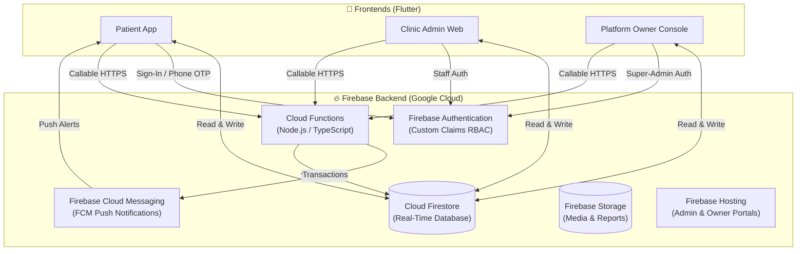

<div align="center">

# 🔥 QueueFlow — Firebase Backend Services

### *Serverless Architecture, Real-Time Sync, and Cloud Automation*

**The cloud backend infrastructure powering the QueueFlow outpatient booking and live queue ecosystem.**

[](https://firebase.google.com)
[](https://firebase.google.com/docs/functions)
[](https://www.typescriptlang.org)
[](https://firebase.google.com/docs/firestore)
[](https://firebase.google.com/docs/cloud-messaging)
[](../LICENSE)

<br/>

**Atomic Token Allocation · Real-Time Snapshot Sync · Multi-Tenant RBAC Rules · Cloud Messaging · Local Emulators**

<br/>

[Overview](#-overview) •
[Backend Services](#-backend-services-architecture) •
[Database Schema](#-firestore-database-schema) •
[Cloud Functions](#-cloud-functions-api--triggers) •
[Security Rules](#-firestore-security-rules--rbac) •
[Local Emulators](#-local-emulator-suite-setup) •
[Deployment](#-deployment-guide)

<br/>

</div>

---

## 📖 Overview

The **QueueFlow Backend** is a 100% serverless, event-driven infrastructure built on **Firebase & Google Cloud**. It provides the core business logic, real-time database synchronization, push notification pipelines, and multi-tenant security guarantees required across all three QueueFlow applications (Patient App, Clinic Admin, and Platform Owner).

Rather than trusting client devices with sensitive business rules, critical operations—such as **atomic token generation**, **double-booking prevention**, **tier quota enforcement**, and **queue state progression**—are strictly verified and executed by server-side Cloud Functions and enforced by Cloud Firestore Security Rules.

```
┌────────────────────────────────────────────────────────────────────────┐
│                        🔥 Firebase Backend Core                        │
├─────────────────┬──────────────────┬─────────────────┬─────────────────┤
│  ⚡ Cloud       │  🔄 Firestore    │  🔔 FCM Cloud   │  🛡️ Security    │
│     Functions   │     Real-Time DB │     Messaging   │     Rules & RBAC│
│                 │                  │                 │                 │
│ Atomic tokens,  │ Sub-second sync  │ Approaching-    │ Scoped tenant   │
│ slot validation,│ to patient apps  │ turn alerts &   │ data isolation  │
│ SaaS plan limits│ & admin portals  │ status reminders│ & custom claims │
└─────────────────┴──────────────────┴─────────────────┴─────────────────┘
```

---

## 🏗️ Backend Services Architecture



---

## 🗄️ Firestore Database Schema

Firestore stores multi-tenant documents with structured IDs and normalized root collections:

### 1. Root Collections & Data Models

| Collection | Key Document ID | Description & Key Fields |
|---|---|---|
| `users` | `{userId}` (Auth UID) | `name`, `email`, `phone`, `role` (`customer` \| `staff` \| `admin`), `fcmToken`, `createdAt` |
| `clinics` | `{clinicId}` | `name`, `category`, `address`, `lat`, `lng`, `phone`, `planId`, `isQueueOpen`, `operatingHours` |
| `services` | `{serviceId}` | `clinicId`, `name`, `durationMin`, `price`, `assignedDoctorIds`, `isActive` |
| `doctors` | `{doctorId}` | `clinicId`, `name`, `specialty`, `room`, `schedule`, `isActive` |
| `appointments` | `{appointmentId}` | `bookingRef` (`QF-48210`), `clinicId`, `customerId`, `doctorId`, `serviceId`, `date`, `timeSlot`, `status` |
| `queues` | `{queueId}` (`{clinicId}_{date}`) | `clinicId`, `doctorId`, `date`, `currentToken`, `totalIssued`, `waitingCount`, `avgWaitMin`, `status` |
| `tickets` | `{ticketId}` | `token` (`A-024`), `queueId`, `clinicId`, `customerId`, `customerName`, `position`, `status`, `joinedAt`, `calledAt` |
| `invoices` | `{invoiceId}` | `clinicId`, `planId`, `amount`, `currency`, `status` (`paid` \| `pending`), `date`, `pdfUrl` |
| `audit_logs` | `{logId}` | `action`, `actorUid`, `actorRole`, `targetResource`, `payload`, `timestamp` |

---

## ⚡ Cloud Functions API & Triggers

All backend automation lives in `backend/functions/src/` written in TypeScript:

### 1. Queue Automation & Token Allocation
- **`joinQueue(clinicId, doctorId)` [Callable HTTPS]:**
  - Runs a Firestore transaction on the active `queues/{queueId}` document.
  - Generates the next sequential human-readable token (e.g. `A-024`).
  - Increments `totalIssued` and recalculates `waitingCount`.
  - Guarantees zero duplicate tokens even during concurrent patient requests.
- **`callNextTicket(clinicId, queueId)` [Callable HTTPS]:**
  - Validates staff credentials and clinic scope.
  - Updates current serving token from `A-023` to `A-024`.
  - Changes previous ticket status to `COMPLETED` and new ticket to `CALLED`.
  - Dispatches immediate FCM push alert to the called patient.
- **`skipTicket(ticketId, reason)` [Callable HTTPS]:**
  - Moves active ticket to `SKIPPED` status and logs the skipping reason.

### 2. Appointment Booking Engine
- **`bookAppointment(bookingData)` [Callable HTTPS]:**
  - Verifies date/time slot availability to avoid conflicts.
  - Generates unique reference code (e.g., `QF-48210`).
  - Creates the appointment record with `CONFIRMED` status.
  - Schedules pre-appointment reminder notifications.

### 3. Automated FCM Notification Triggers
- **`onTicketUpdated` [Firestore Background Trigger]:**
  - Fires whenever a ticket or queue document updates.
  - Checks if a patient is **2 tokens away** ($N=2$) $\rightarrow$ Sends *"Almost your turn! 2 people ahead"* alert.
  - Checks if status changes to `CALLED` $\rightarrow$ Sends *"Please enter Room 3, your token is being served!"* notification.

### 4. SaaS Tier Quota Enforcement
- **`enforceClinicLimits` [Firestore Pre-Write Trigger]:**
  - Validates doctor and service creation against the clinic's assigned plan tier:
    - **Solo Doctor:** Maximum 1 active doctor profile & 1 service.
    - **Multi-Doctor:** Maximum 10 active doctor profiles & 10 services.
    - **Enterprise:** Unlimited.
  - Rejects write requests that exceed plan allowances.

---

## 🛡️ Firestore Security Rules & RBAC

QueueFlow uses a multi-layered security model combining **Firebase Authentication Custom Claims** with **Firestore Security Rules**:

```text
                                  User JWT
                                     │
           ┌─────────────────────────┼─────────────────────────┐
           ▼                         ▼                         ▼
   role: "customer"            role: "staff"             role: "admin"
   (Patient App)               (Clinic Admin)            (Platform Owner)
   • Access own tickets        • Scoped to clinicId      • Platform-wide access
   • Access own bookings       • Roster management       • Subscription plans
   • Read public clinics       • Queue caller actions    • Billing & Invoices
```

### Excerpt from `firestore.rules`:
```javascript
rules_version = '2';
service cloud.firestore {
  match /databases/{database}/documents {

    // Helper functions
    function isAuthenticated() {
      return request.auth != null;
    }
    
    function isSuperAdmin() {
      return isAuthenticated() && request.auth.token.role == 'admin';
    }

    function isClinicStaff(clinicId) {
      return isAuthenticated() && 
        request.auth.token.role == 'staff' && 
        request.auth.token.clinicId == clinicId;
    }

    function isOwner(userId) {
      return isAuthenticated() && request.auth.uid == userId;
    }

    // Public clinic listings
    match /clinics/{clinicId} {
      allow read: if true;
      allow write: if isSuperAdmin();
    }

    // Appointments scoped to patient and clinic staff
    match /appointments/{appointmentId} {
      allow read: if isAuthenticated() && (
        resource.data.customerId == request.auth.uid || 
        isClinicStaff(resource.data.clinicId) || 
        isSuperAdmin()
      );
      allow create: if isAuthenticated() && request.resource.data.customerId == request.auth.uid;
      allow update: if isClinicStaff(resource.data.clinicId) || isSuperAdmin();
    }

    // Queue Tickets - Updates only permitted via trusted Cloud Functions or authorized staff
    match /tickets/{ticketId} {
      allow read: if isAuthenticated() && (
        resource.data.customerId == request.auth.uid || 
        isClinicStaff(resource.data.clinicId) ||
        isSuperAdmin()
      );
      allow write: if isClinicStaff(resource.data.clinicId) || isSuperAdmin();
    }

    // Immutable Audit Logs: Read-only for Admin, Writes only from trusted backend
    match /audit_logs/{logId} {
      allow read: if isSuperAdmin();
      allow write: if false; // Only Cloud Functions using Admin SDK can write
    }
  }
}
```

---

## 📂 Backend Folder Structure

```text
backend/
│
├── functions/                      # Firebase Cloud Functions (Node.js)
│   ├── src/
│   │   ├── appointments/           # Slot reservation & conflict validators
│   │   │   └── booking_service.ts
│   │   ├── queues/                 # Atomic token generator & state caller
│   │   │   ├── token_allocator.ts
│   │   │   └── queue_caller.ts
│   │   ├── notifications/          # FCM trigger handlers & message templates
│   │   │   └── push_dispatcher.ts
│   │   ├── subscriptions/          # SaaS limit checkers & billing handlers
│   │   │   └── plan_guard.ts
│   │   ├── utils/                  # Firebase Admin SDK & shared helpers
│   │   │   └── admin_init.ts
│   │   └── index.ts                # Cloud Functions root exports
│   │
│   ├── package.json                # Dependencies (@google-cloud, firebase-admin)
│   ├── tsconfig.json               # TypeScript compiler configuration
│   └── .eslintrc.js                # Linter configuration
│
├── firestore.rules                 # Cloud Firestore access control rules
├── firestore.indexes.json          # Compound queries performance indexes
├── storage.rules                   # Cloud Storage permissions
├── firebase.json                   # Project config & emulator definitions
└── README.md
```

---

## 🧪 Local Emulator Suite Setup

Develop and test backend logic locally without touching production or incurring cloud costs:

### 1. Prerequisites
- [Node.js](https://nodejs.org/) (`>= 18.x`) & npm
- [Java Development Kit (JDK 17+)](https://www.oracle.com/java/) (required for Firebase Local Emulators)
- [Firebase CLI](https://firebase.google.com/docs/cli):
  ```bash
  npm install -g firebase-tools
  ```

### 2. Install Functions Dependencies
```bash
cd backend/functions
npm install
npm run build
cd ..
```

### 3. Start the Emulators
From the `backend/` directory:
```bash
firebase emulators:start
```

The emulators spin up with an interactive web UI:
- **Emulator UI:** `http://localhost:4000`
- **Firestore Emulator:** `localhost:8080`
- **Authentication Emulator:** `localhost:9099`
- **Functions Emulator:** `localhost:5001`
- **Storage Emulator:** `localhost:9199`

### 4. Seed Test Data (Optional)
Run the automated seed script to populate sample clinics, doctors, and services:
```bash
cd backend/functions
npm run seed:emulator
```

---

## 🚀 Deployment Guide

### Prerequisites
Sign in to your Firebase account and select the active project:
```bash
firebase login
firebase use <PROJECT_ID>
```

### 1. Deploy Firestore Security Rules & Indexes
```bash
firebase deploy --only firestore:rules,firestore:indexes
```

### 2. Deploy Cloud Storage Rules
```bash
firebase deploy --only storage
```

### 3. Deploy Cloud Functions
```bash
cd backend/functions
npm run build
cd ..
firebase deploy --only functions
```

### 4. Full Backend Deployment
To deploy all backend resources in a single command:
```bash
firebase deploy --only firestore,storage,functions
```

---

## ⚙️ Environment Variables & Secrets

Sensitive keys (e.g., third-party SMS gateways, payment gateways) must be managed using Firebase Cloud Functions Secrets Manager:

```bash
# Set a secret key
firebase functions:secrets:set PAYMENT_GATEWAY_KEY

# Deploy functions with secret access
firebase deploy --only functions
```

> [!CAUTION]
> Never store service-account JSON keys, private certificates, or database credentials inside source control.

---

<div align="center">

Part of the **[QueueFlow Monorepo](../README.md)** ecosystem.

<br/>

Built with 🔥 using **Firebase & Google Cloud Platform**

</div>