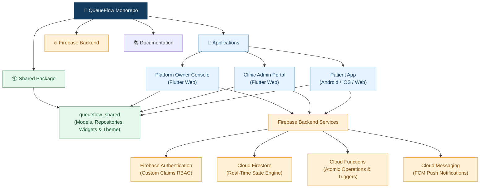
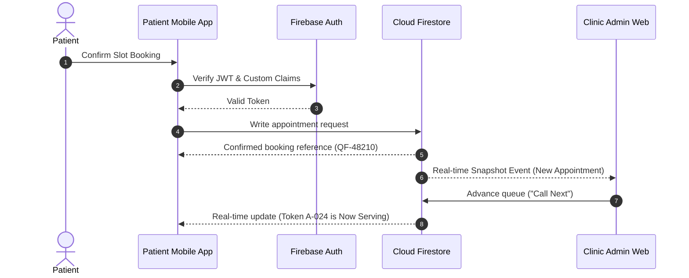

<div align="center">

# 🏥 QueueFlow

### *Smart Clinic Appointments & Real-Time Queue Management*

**A unified, multi-application healthcare platform built with Flutter, Firebase, and Clean Monorepo Architecture.**

[](https://flutter.dev)
[](https://dart.dev)
[](https://firebase.google.com)
[](#-system-architecture)
[](#-applications--responsibilities)
[](LICENSE)
[](#-git-workflow--contributing)

<br/>

<p align="center">
  <b>One Repository · Three Applications · One Connected Healthcare Platform</b>
</p>

<br/>

[Overview](#-overview) •
[Architecture](#-system-architecture) •
[Folder Structure](#-monorepo-folder-structure) •
[App Suite](#-applications--responsibilities) •
[Clean Architecture](#-feature-first-clean-architecture) •
[Shared Package](#-shared-package-guide) •
[Firebase Backend](#-firebase-backend--security) •
[Getting Started](#-getting-started) •
[Testing](#-testing--code-quality)

<br/>

</div>

---

## 📌 Overview

**QueueFlow** is a multi-application healthcare platform designed to simplify clinic appointments, manage patient queues in real time, and eliminate waiting room congestion. 

Built with **Flutter and Firebase**, the platform uses a **Monorepo Architecture** to maintain three distinct, purpose-driven applications alongside shared libraries inside a single unified Git repository:

- 📱 **Patient App:** Outpatient discovery, 4-step appointment booking, and real-time live queue tracking.
- 🏥 **Clinic Admin Portal:** Live queue calling console, walk-in registration, doctor rostering, and clinic operations.
- 👑 **Platform Owner Console:** Multi-clinic directory, SaaS subscription plans, billing oversight, and system analytics.

---

## 🏗️ System Architecture

QueueFlow follows a **Monorepo + Feature-First Clean Architecture** design pattern. All applications share common models, design tokens, and domain contracts while maintaining fully independent runtime boundaries.



### 💡 Why a Monorepo?

Instead of maintaining 3 separate Git repositories with duplicated models and diverging dependencies, QueueFlow consolidates everything into a single repository:

- 🔄 **Unified Codebase:** Synchronized breaking changes across client and admin apps in atomic commits.
- ♻️ **Single Source of Truth:** Shared data models, validation logic, and design tokens in `packages/queueflow_shared`.
- 🛠️ **Consistent Standards:** Uniform static analysis (`analysis_options.yaml`), formatting, and CI/CD pipelines.
- 🎯 **Domain Isolation:** Strict separation of client-specific routing, UI states, and permissions.

---

## 📂 Monorepo Folder Structure

```text
queueflow/
│
├── apps/
│   │
│   ├── patient_app/                # Mobile application (Android, iOS, Web)
│   │   ├── android/
│   │   ├── ios/
│   │   ├── web/
│   │   ├── lib/
│   │   │   ├── core/               # Routing, constants, theme, network exceptions
│   │   │   ├── features/           # Feature-First modules
│   │   │   │   ├── authentication/
│   │   │   │   ├── clinics/
│   │   │   │   ├── appointments/
│   │   │   │   ├── queue_tracking/
│   │   │   │   └── notifications/
│   │   │   ├── app.dart            # MaterialApp configuration
│   │   │   └── main.dart           # App entrypoint
│   │   ├── test/                   # Unit & Widget tests
│   │   └── pubspec.yaml
│   │
│   ├── clinic_admin/               # Responsive Web app for clinic staff & doctors
│   │   ├── lib/
│   │   │   ├── core/
│   │   │   ├── features/
│   │   │   │   ├── authentication/
│   │   │   │   ├── dashboard/
│   │   │   │   ├── queue_management/  # Caller console (Call Next, Skip, Complete)
│   │   │   │   ├── appointments/      # Calendar & list views, walk-in intake
│   │   │   │   ├── doctors/           # Doctor rosters & room allocations
│   │   │   │   └── clinic_settings/   # Hours, breaks, queue cutoffs
│   │   │   ├── app.dart
│   │   │   └── main.dart
│   │   ├── test/
│   │   └── pubspec.yaml
│   │
│   └── platform_owner/             # Centralized Web console for SaaS administration
│       ├── lib/
│       │   ├── core/
│       │   ├── features/
│       │   │   ├── authentication/
│       │   │   ├── dashboard/
│       │   │   ├── clinic_management/ # Multi-clinic onboarding & suspension
│       │   │   ├── subscriptions/     # Tier limits (Solo, Multi-Doctor, Enterprise)
│       │   │   ├── billing/           # MRR KPIs & invoice history
│       │   │   └── analytics/         # Platform usage trends
│       │   ├── app.dart
│       │   └── main.dart
│       ├── test/
│       └── pubspec.yaml
│
├── packages/
│   └── queueflow_shared/           # Shared package consumed by all three applications
│       ├── lib/
│       │   ├── core/               # Common utilities, date/time formatters, constants
│       │   ├── models/             # DTOs: User, Clinic, Doctor, Appointment, Ticket, Queue
│       │   ├── repositories/       # Shared repository contracts & base datasources
│       │   ├── widgets/            # Reusable UI components (buttons, badges, modals)
│       │   └── queueflow_shared.dart # Umbrella export file
│       ├── test/
│       └── pubspec.yaml
│
├── backend/
│   ├── functions/                  # Cloud Functions (TypeScript/Node.js)
│   ├── firestore.rules             # Role-based database security rules
│   ├── firestore.indexes.json      # Optimized Firestore compound query indexes
│   └── storage.rules               # Cloud Storage security rules
│
├── docs/                           # Technical documentation, API specs, diagrams
├── .gitignore
├── analysis_options.yaml           # Repository-wide Dart linter rules
└── README.md
```

---

## 📱 Applications & Responsibilities

| Application | Primary Target | Platform | Key Capabilities |
|---|---|---|---|
| **Patient App** | Outpatients & Caregivers | `Android` • `iOS` • `Web` | Clinic search, 4-step slot booking, live token tracker, push reminders, booking history. |
| **Clinic Admin** | Receptionists & Doctors | `Web (Desktop/Tablet)` | High-visibility queue caller console, walk-in entry, schedule calendar, doctor rosters. |
| **Platform Owner** | SaaS Super Admins | `Web (Desktop)` | Tenant onboarding/suspension, plan configurator, MRR metrics, audit logging. |

> [!NOTE]
> Each application maintains its own `main.dart`, `pubspec.yaml`, dependencies, routing table, and application-level state.

---

## 🧱 Feature-First Clean Architecture

QueueFlow standardizes on **Clean Architecture** organized **by Feature** to maintain high maintainability as the codebase grows:

```text
features/
└── appointments/
    ├── data/
    │   ├── datasources/        # Remote Firestore data sources & REST endpoints
    │   ├── models/             # JSON serializable models & DTOs
    │   └── repositories/       # Concrete implementation of domain repository contracts
    │
    ├── domain/
    │   ├── entities/           # Pure Dart business objects (immutable)
    │   ├── repositories/       # Abstract repository interfaces
    │   └── usecases/           # Single-responsibility business use cases
    │
    └── presentation/
        ├── pages/              # Responsive screen layouts
        ├── widgets/            # Feature-specific UI components
        └── state/              # Riverpod Notifiers or BLoC Cubits
```

### Data Flow Diagram

```text
  [ User Interaction ]
           │
           ▼
  [ Presentation Layer ]  (State Management / UI Widgets)
           │
           ▼
  [ Domain Use Case ]     (Enforces Business Logic & Policies)
           │
           ▼
  [ Repository Contract ] (Abstract Interface)
           ▲
           │ implements
  [ Repository Impl ]     (Data Layer)
           │
           ▼
  [ Data Source ]         (Firestore / Cloud Functions / Local Cache)
```

---

## 📦 Shared Package Guide

The `queueflow_shared` package encapsulates code shared across two or more applications.

### 1. Link in App `pubspec.yaml`
```yaml
dependencies:
  flutter:
    sdk: flutter

  queueflow_shared:
    path: ../../packages/queueflow_shared
```

### 2. Export Common Symbols
In `packages/queueflow_shared/lib/queueflow_shared.dart`:

```dart
// Core & Constants
export 'core/constants/app_constants.dart';
export 'core/utils/date_time_formatter.dart';

// Domain & Data Models
export 'models/user_model.dart';
export 'models/clinic_model.dart';
export 'models/appointment_model.dart';
export 'models/queue_model.dart';
export 'models/ticket_model.dart';

// Shared UI Components
export 'widgets/primary_button.dart';
export 'widgets/status_badge.dart';
export 'widgets/loading_indicator.dart';
```

> [!IMPORTANT]
> Keep application-specific screens, routing logic, and proprietary state containers inside their respective apps. Do not treat `queueflow_shared` as a dumping ground for single-app features.

---

## 🔥 Firebase Backend & Security

QueueFlow relies on Firebase managed services for real-time synchronization, serverless transactions, and infrastructure:

| Firebase Service | Purpose |
|---|---|
| **Firebase Authentication** | User identity, phone OTP, email/password, and JWT Custom Claims. |
| **Cloud Firestore** | Real-time multi-tenant NoSQL database with snapshot listeners. |
| **Firebase Cloud Functions** | Atomic token incrementation, status transitions, and automated workflows. |
| **Firebase Cloud Messaging** | Low-latency push notifications for approaching queue turns. |
| **Firebase Storage** | Medical documentation, doctor avatars, and clinic media. |
| **Firebase Hosting** | High-performance CDN hosting for Admin and Owner web applications. |

### Real-Time Request Lifecycle



### 🔐 Security Principles
- **No Client-Side Token Assignment:** Token IDs and queue positions are generated exclusively via Cloud Functions / Firestore Transactions to avoid concurrency conflicts.
- **Tenant Scoping:** Staff permissions are strictly scoped to their assigned `clinicId` in Firestore Security Rules.
- **Role Isolation:** Ordinary users cannot read private clinic records or invoke platform-owner administrative functions.
- **Secrets Management:** Service accounts, API keys, and environment secrets must never be committed to Git.

---

## 🛠️ Tech Stack

| Component | Technology | Description |
|---|---|---|
| **Framework** | [Flutter](https://flutter.dev) (Dart 3.x) | Cross-platform UI toolkit for Android, iOS, and Web |
| **State Management** | [Riverpod](https://riverpod.dev) or [BLoC](https://bloclibrary.dev) | Standardized, unidirectional reactive state architecture |
| **Database** | [Cloud Firestore](https://firebase.google.com/docs/firestore) | Real-time synchronized NoSQL database |
| **Authentication** | [Firebase Auth](https://firebase.google.com/docs/auth) | Phone OTP, Email/Password & RBAC Custom Claims |
| **Serverless Engine** | [Cloud Functions](https://firebase.google.com/docs/functions) | TypeScript / Node.js atomic backend triggers |
| **Notifications** | [Firebase Cloud Messaging](https://firebase.google.com/docs/cloud-messaging) | Real-time queue turn alerts |
| **Deployment** | [Firebase Hosting](https://firebase.google.com/docs/hosting) | Production web hosting for Admin & Owner portals |

---

## 🚀 Getting Started

### Prerequisites
- [Flutter SDK](https://docs.flutter.dev/get-started/install) (`>= 3.20.0`)
- [Dart SDK](https://dart.dev/get-dart) (`>= 3.3.0`)
- [Git](https://git-scm.com/)
- [Node.js](https://nodejs.org/) (`>= 18.x`) & npm
- [Firebase CLI](https://firebase.google.com/docs/cli) (`npm install -g firebase-tools`)
- [FlutterFire CLI](https://firebase.flutter.dev/docs/cli/) (`dart pub global activate flutterfire_cli`)

### 1. Clone the Repository
```bash
git clone https://github.com/your-username/queueflow.git
cd queueflow
```

### 2. Scaffold Monorepo (If Starting Fresh)
```bash
mkdir apps packages backend docs

flutter create --platforms=android,ios,web apps/patient_app
flutter create --platforms=web apps/clinic_admin
flutter create --platforms=web apps/platform_owner

flutter create --template=package packages/queueflow_shared
```

### 3. Initialize Shared Package
```bash
cd packages/queueflow_shared
flutter pub get
cd ../..
```

### 4. Connect Firebase Projects
```bash
firebase login

# Configure each application with FlutterFire:
cd apps/patient_app && flutterfire configure && cd ../..
cd apps/clinic_admin && flutterfire configure && cd ../..
cd apps/platform_owner && flutterfire configure && cd ../..
```

### 5. Run the Applications

<details open>
<summary><b>📱 Run Patient Mobile App</b></summary>

```bash
cd apps/patient_app
flutter pub get
flutter run
```
</details>

<details>
<summary><b>🏥 Run Clinic Admin Web Portal</b></summary>

```bash
cd apps/clinic_admin
flutter pub get
flutter run -d chrome
```
</details>

<details>
<summary><b>👑 Run Platform Owner Web Console</b></summary>

```bash
cd apps/platform_owner
flutter pub get
flutter run -d chrome
```
</details>

<details>
<summary><b>⚡ Run Firebase Cloud Functions & Local Emulators</b></summary>

```bash
cd backend/functions
npm install
npm run build
firebase emulators:start
```
</details>

---

## 🧪 Testing & Code Quality

Run static analysis and test suites across the monorepo:

```bash
# Analyze all apps and packages
flutter analyze apps/patient_app
flutter analyze apps/clinic_admin
flutter analyze apps/platform_owner
flutter analyze packages/queueflow_shared

# Execute unit and widget tests
flutter test apps/patient_app
flutter test apps/clinic_admin
flutter test packages/queueflow_shared

# Format all Dart files
dart format .
```

---

## 🌿 Git Workflow & Contributing

QueueFlow utilizes a structured trunk-based feature branch workflow:

```text
main (stable production releases)
 ├── feature/patient-auth-flow
 ├── feature/appointment-booking-wizard
 ├── feature/live-queue-caller
 ├── feature/doctor-roster-management
 └── feature/saas-subscription-billing
```

### Recommended Contribution Steps
1. Create a descriptive branch: `git checkout -b feature/queue-caller-ui`
2. Implement features following Clean Architecture layers.
3. Run `flutter analyze` and `flutter test` before committing.
4. Open a Pull Request referencing the feature specification.

---

## 🗺️ 5-Week Implementation Roadmap

| Milestone | Primary Focus | Key Deliverables |
|---|---|---|
| **Week 1** | Foundation & Authentication | Monorepo structure, shared models, Firebase Auth RBAC, and Firestore seed data. |
| **Week 2** | Patient Application | Clinic discovery, 4-step booking wizard, live queue tracker, and notification inbox. |
| **Week 3** | Clinic Admin Web Portal | Queue caller console (`Call Next`, `Skip`), calendar views, rosters, and walk-in intake. |
| **Week 4** | Cloud Automation & Owner Console | Atomic Cloud Functions for token dispatch, push notifications, and SaaS MRR dashboard. |
| **Week 5** | QA, Hardening & Deployment | Firebase Hosting web deploys, release app bundles, load testing, and rule audits. |

---

<div align="center">

**One repository · Three applications · One connected healthcare platform.**

<br/>

Built with ❤️ using **Flutter and Firebase**

</div>